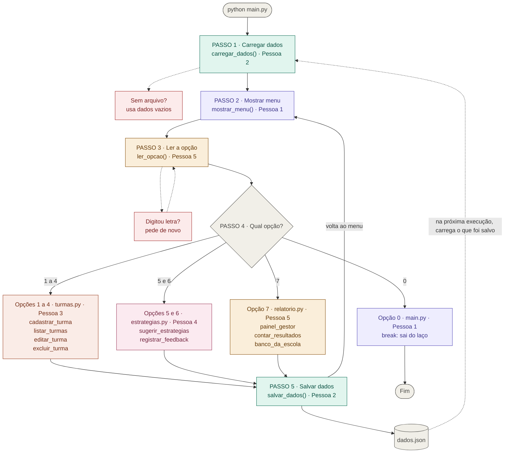

# MIAU — Missões Inclusivas de Aprendizagem Universal

Protótipo em Python, no terminal, para a disciplina Fundamentos da Programação.

## Como rodar

```
python main.py
```

O programa cria o arquivo `dados.json` sozinho na primeira vez.

## Fluxograma

Cada cor é uma pessoa do grupo. As caixas vermelhas são tratamento de erro.



## Quem faz o quê

| Pessoa | Arquivo | Tarefa |
|---|---|---|
| 1 | `main.py` | Menu e integração das partes |
| 2 | `arquivos.py` | Salvar e carregar o `dados.json` |
| 3 | `turmas.py` | CRUD de turmas |
| 4 | `estrategias.py` | Sugestão de DUA e feedback |
| 5 | `relatorio.py` | `ler_opcao` e painel do gestor |

## Regras do grupo

1. Cada pessoa mexe só no seu arquivo.
2. Não mude o nome das funções. Outros arquivos chamam essas funções.
3. Não mude o formato dos dados sem avisar o grupo.
4. Procure os comentários `TODO`. Eles mostram o que falta fazer.
5. Apague as linhas marcadas com `APAGUE` quando terminar a função.
6. A Pessoa 5 termina `ler_opcao` primeiro, porque todos usam essa função.

## Formato combinado dos dados

```python
dados = {
    "turmas": [
        {"id": 1, "nome": "8A", "serie": "8º ano", "barreiras": ["atencao", "leitura"]}
    ],
    "feedbacks": [
        {"turma_id": 1, "estrategia": "Etapas numeradas", "resultado": "funcionou"}
    ],
    "proximo_id": 2
}
```

## Critérios do professor

| Critério | Onde está |
|---|---|
| CRUD | `turmas.py` |
| Lista, tupla e dicionário | todos os arquivos |
| Funções e modularização | 5 arquivos separados |
| Manipulação de arquivos | `arquivos.py` |
| Tratamento de exceções | `arquivos.py`, `relatorio.py`, `turmas.py`, `estrategias.py` |
